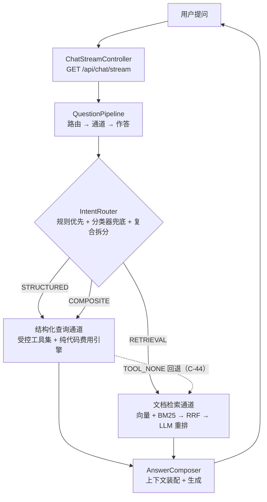

# CanalMind（运河智答）

> 平陆运河航运物流智能业务助手 — 面向内河航运场景的**双通道智能业务问答系统**

[]()
[]()
[]()
[]()
[]()

---

## ⚠️ 先读这一段：项目性质交底

**CanalMind 是一个个人技术验证项目。**

- **语料与业务数据均为本地仿真**：规则语料（`docs/规则语料/`，26 篇，编号 01–26）是**自建仿真文本**，
  业务库是**脚本生成的仿真数据**（固定随机种子 `20260918`，可完整重现）。
- **不含任何真实业务数据，不代表真实费率与政策。** 表结构与计费规则按**公开的内河航运业务逻辑**设计，
  但数字是仿真的。⛔ **不要基于本仓库的数据对外宣称任何业务结论。**
- **技术指标只讲有出处的**：本文档出现的每个数字都能在
  [`docs/评测报告/评测报告.md`](docs/评测报告/评测报告.md) 里定位到，且**都能按报告 §7 的命令重跑**。
  ⛔ 本项目不使用无基线、无 Golden Set、无消融的数字。
- ⚠️ **数据时间窗是"前瞻模拟"**：平陆运河 2026-09-16 正式通航，本项目仿真数据窗口取通航后一年
  （`2026-09-16 ~ 2027-09-15`，系统"今天"= **2027-09-15**）。**数据中的日期晚于真实日期**，
  原因是若窗口截至真实今天，运河专项查询几乎没有数据支撑。详见 `docs/数据模型-ER图.md`。

---

## 项目解决了什么问题

通用大模型答不好航运业务问题，根因是**答案分散在两个地方**：

| 问题类型 | 例子 | 权威载体 |
|---|---|---|
| 规则/流程类 | "出口报关需要哪些材料？" | **规则文档** |
| 数值/聚合类 | "六景到广州港 100 吨水泥运费多少？" | **业务数据库** |

单一 RAG 只能覆盖前者，且**模型算术不可信**。CanalMind 的做法不是"检索文档"，
而是**先判断该查哪儿，再去查**。

## 核心设计



> 完整架构图（含时序、评测闭环、数据层演进）见 **[`docs/架构图.md`](docs/架构图.md)**。

### 三个关键技术决策

1. **模型只抽参数，不算钱** — 金额由确定性代码 `FeeCalculationEngine` 计算。
   实测与库内 `fee_record` **200/200 逐分一致**；L5 层"金额是否算对"的客观判据 **17/17 = 1.0000**。
2. **结构化查询用 JSON Schema 契约约束**，不让模型自由生成 SQL（安全性与正确性优先于灵活性）。
   ⚠️ 实测边界：`limit` 超上限与 `group_by` 注入**当前连 `SchemaGate` 都没拦住**，已登记为待修项。
3. **评测分口径而不是分函数**：客观正确性用**数据库执行结果做 oracle**，主观质量才交给 LLM Judge；
   严格口径（只算 gold，**读作下界**）与可答口径（含等价块）**并列报告、⛔ 不得混用**。

## 评测结果

**六层 Golden Set 160 题，160/160 已出分**。完整方法与逐题归因见
**[`docs/评测报告/评测报告.md`](docs/评测报告/评测报告.md)**（唯一出处）。

| 层 | 考什么 | 主口径 | 通过 | ⚠️ 必读限定 |
|---|---|---|---|---|
| **L1** | 结构化查询准确性 | Execution Accuracy（oracle） | **1.0000**（40/40） | **分段口径**：题面已含全部参数，不考检索/路由/措辞 ⇒ 不可外推为"整体答对率" |
| **L2** | 检索质量 | `HitRate@5`（纯规则） | **0.9250**（37/40） | 只算 gold ⇒ **读作下界**；`@30` = 0.9750、`MRR@30` = 0.7744、`answerableTop1` = 0.7000 |
| **L3** | 无答案拒答 | LLM Judge（严格） | **0.8000**（16/20） | 宽松口径 **0.9000**；判分端 1 题空应答 ⇒ **下界** |
| **L4** | 多轮参数继承 | rule（工具 + 实参逐键） | **0.6000**（15/25） | 逐轮口径 **0.7200**（36/50）；判据为"全键精确相等"⇒ **下界**（已知 2 处误伤） |
| **L5** | 复合意图 | LLM Judge（严格） / **规则（金额）** | **0.1500**（3/20） / **1.0000**（17/17） | ⚠️ **两个口径差 6.7 倍，必须成对引用**（见下） |
| **L6** | 契约守卫 | LLM Judge（严格） / 规则（工具状态） | **0.4000**（6/15） / **0.4000**（6/15） | 宽松口径 **0.4667**；**5 类实现缺口已登记为待修**，按现状上限为 0.80 |

### ⚠️ 三条口径纪律（否则上表会误导）

1. **L5 的 0.1500 与 1.0000 不矛盾，必须成对引用**：**金额 100% 正确**（纯代码算，
   所以只要参数与费率版本对，金额就不可能错），但**依据大面积引错版本**
   ——典型失败模式是"**取到了对的费率版本、却引了错版本的条款**"（业务日 2027 年，引了 2026 版条款）。
   ⛔ 单引其中任何一个都会误导。
2. **含 Judge 的口径一律是下界**：判分端仍有少量**空应答**（L3 1/20、L6 1/15、L5 2/20），按 0 分计入。
   ⚠️ **Judge 与被测系统是同一个模型**，知识库点名的**自增强偏差未被排除**（本机端点下无法换裁判模型）
   ⇒ Judge 分数只能与同一 Judge 的历史分数**纵向比**，⛔ 不可当作绝对真值。
3. **L1/L2 是分段口径，L3–L6 是行为口径**（要经过完整的路由→通道→作答编排）
   ⇒ ⛔ **不可平均、不可相加成一个"总通过率"**。

### 消融实验（规格书 §6.3，6/6 已出数）

| 实验 | 结论（同一批 40 题 L2 数据） |
|---|---|
| **基线｜纯向量** | `HitRate@1` **0.6750** ← 基线 |
| **+Rerank**（D3 判决臂） | **0.6750 → 0.9250（+25.0 pt）**，`MRR@30` +0.176、`answerableTop1` 0.7000 → **1.0000** ⇒ **本项目测得的最大单项增益**。⚠️ `@30` 上**不加分**——重排改善的是"把对的排到前面"，不是"多召回" |
| **+混合检索（RRF）** | **无重排时反而更差**：`HitRate@1` **0.5250（−15.0 pt）**、`MRR@30` −0.0746；只有 `@30` 召回被补全（0.975 → 1.000） ⇒ 数据支持 **C-30「混合检索暂不启用」**，并把「LLM 重排」提为准默认 |
| **Chunk 策略**（固定长度 vs 结构感知） | **10 项指标固定长度侧 10 项全低**，且固定长度侧**被结构性偏袒 2.7 倍**（一条 gold 平均被 1.93 个窗口覆盖）⇒ 结论**保守成立**；差距在头部最大（`@1` −12.5 pt、`@5` −20.0 pt） |
| **+Query Rewrite** | 三臂：未改写 `@1` **0.4375** → LLM 改写 **0.5000** → 人工上界 **0.7500**；`@10` 改写臂**已达 1.0000**。⇒ **改写把「召回」补全了，却几乎没补「排序」**（只抓住上界空间的 **20%**，真实 +6.25 pt，⛔ 不是上界的 +31.25 pt） |
| **Prompt v1 vs v2** | **v2 无增益、反而更低**：严格 **3/20 → 0/19**、宽松 **4/20 → 3/19**，而两臂客观判据均 **17/17** ⇒ **模型知道要引依据，瓶颈在作答内容质量**。⛔ 不得声称"Prompt 优化提升了 L5" |

> ⚠️ **横比纪律**：以上各臂**必须同一数据集、同一语料版本、同一构建**才可比。
> 报告里对每一处不可比都做了显式标注（例如"RRF+重排"那一路是**改前语料**的旧产物）。

## 技术栈

| 层 | 选型 | 版本确定的依据 |
|---|---|---|
| 语言 / 构建 | Java **21** + Maven 3.9.12 | 本机实测环境 |
| 框架 | Spring Boot **3.5.9** + Spring AI **1.1.2** | 决策 **C-16**。⚠️ 本地 Maven 仓库里**不存在 Spring AI 2.x**，知识库提到的版本已过时——**不得照抄知识库版本号** |
| 模型 | DeepSeek API（`deepseek-v4-flash`，经中转端点） | 生成 / 参数抽取 / 重排 / LLM Judge |
| 嵌入 | **Ollama + `bge-m3`**（本地，1024 维） | 决策 **C-22**。⚠️ **索引与查询必须同一模型**，混用会"测试正常、上线召回率腰斩" |
| 数据库 | PostgreSQL **18.4** + pgvector **0.8.0** + btree_gist | 决策 **C-15**（PG18 不兼容 pgvector 0.7 及以下） |
| 分词 | jieba-analysis 1.0.2 + **自建航运词典**（164 词） | 决策 **C-25**。⚠️ 本机 PG18 扩展目录里**没有任何中文分词器** |
| 观测 | Micrometer Observation / OpenTelemetry (OTLP) | 🚧 业务 Span 用 **Micrometer Observation API**（实测类路径已有 `micrometer-observation` 1.15.7）；⛔ **OTLP 导出与 tracing bridge 未接入**（D15 待决） |
| 部署 | 本机 PostgreSQL + Redis（**不使用 Docker**，决策 **C-12**） | 仓库内 `docker-compose.yml` 保留给他人 clone 后试用，**不是本项目主路径** |

## 快速开始

### 前置要求

| 依赖 | 版本 | 说明 |
|---|---|---|
| JDK | **21** | |
| Maven | 3.9+ | 本项目未提供 `mvnw` |
| PostgreSQL | **18** | 需扩展 `btree_gist`、`vector` |
| pgvector | **0.8.x** | ⚠️ PG18 不兼容 0.7 及以下 |
| Ollama | — | 需 `bge-m3`（本地嵌入，**不产生 API 花费**） |
| Python | 3.10+ | 仅用于仿真数据生成与评测脚本 |

### 一键演示（推荐先跑这个）

```powershell
# 默认零付费：环境 → 资产自检 → 路由 → 检索 → 分层通过率（全部本地计算）
powershell -ExecutionPolicy Bypass -File backend\scripts\demo.ps1

# 追加一次真实端到端问答（⚠️ 会调用付费模型）
powershell -ExecutionPolicy Bypass -File backend\scripts\demo.ps1 -IncludePaid

# 追加全量测试（离线，约 40 秒）
powershell -ExecutionPolicy Bypass -File backend\scripts\demo.ps1 -WithTests
```

> ⚠️ **用 `powershell`（Windows PowerShell 5.1+），不要写 `pwsh`**：本机**没有安装 PowerShell 7**
> （实测 `Get-Command pwsh` 为空），`pwsh -File …` 会直接报"不是内部或外部命令"。
> 脚本本身在 **5.1 上实测跑通**（退出码 0）。
> 这也是本仓库既有脚本的统一写法（如 `backend/scripts/verify_env.ps1`）。

演示脚本**默认不产生任何付费调用**，逐段打印"这一步花了什么、结论是什么"。
⚠️ 长跑务必放后台任务，⛔ 别用会超时的前台调用（本项目多次因此丢过产物）。

### 初始化数据库

```powershell
# 需先设置口令（脚本绝不弹交互提示，无口令会立即失败而非挂起）
$env:PGPASSWORD = "你的口令"
powershell -ExecutionPolicy Bypass -File backend\scripts\setup_local_db.ps1 -Recreate
```

> ⚠️ **脚本没有迁移账本**（类 Flyway 的 `schema_history`）：它按文件名升序应用全部 `V*.sql`，
> 但**对已建库新增的迁移不会自动应用，必须 `-Recreate`**。这是脚本注释里自己记下的已知限制。

### 配置与启动

```bash
cp .env.example .env   # 填入 DEEPSEEK_API_KEY；PG/Ollama 连接参数
cd backend && mvn spring-boot:run
```

> ⚠️ **Spring Boot 不会自动读取 `.env`**（社区惯例，不是 Spring 特性）。
> 仅写 `${DEEPSEEK_API_KEY:}` 占位符**完全无效**——占位符只从「进程环境变量 / JVM 系统属性 /
> 已加载的配置源」取值。表现是**密钥填得好好的，却仍报 `DeepSeek API key must be set`**。
> 故 `application.yml` 用 `spring.config.import` 显式导入 `.env`（两个相对路径都写，
> 因为工作目录随启动方式变化；`optional:` 让文件缺失时不报错）。
> ⚠️ 同理：**所有 `*Cli` 的 DB / Ollama 参数都从进程环境读**，
> 直接用命令行调 CLI 前要先把 `.env` 载入进程（`demo.ps1` 已内置这一步）。

### 验证流式接口

```bash
curl -N "http://localhost:8080/api/chat/stream?question=过闸费怎么算&sessionId=demo"
```

事件类型：`meta` → `token`（增量正文，**换行已转义为字面量 `\n`**）→ `done`；异常以 `error` 结束。

> **转义是接口契约的一部分**：前端必须用同一套语义解码，否则正文里的换行会让 SSE 事件边界错位。
> 约定见 `SseTextCodec`（服务端与前端**必须固定同一种语义**，知识库《大模型 API 调用工程实践》第 124 行）。

### 运行测试

```powershell
# ⚠️ 本机 Maven 缓存的特殊情况导致下面几个参数"一个都不能少"（见 AGENTS.md §7.1/§7.2）
$env:JAVA_HOME = "D:\JDKmove\ms-21.0.12.1"; cd backend
Remove-Item -Recurse -Force target\classes, target\test-classes -ErrorAction SilentlyContinue
mvn -o -s ..\.proto\settings.xml -gs ..\.proto\settings.xml `
  "-Dmaven.repo.local=.m2repo" `
  "-DargLine=-javaagent:.m2repo\org\mockito\mockito-core\5.17.0\mockito-core-5.17.0.jar" test
```

**实测 `Tests run: 530, Failures: 0, Errors: 0, Skipped: 1`**（跳过的一项是需要整跑的执行段评测）。

测试分三层，**刻意分开**，以便失败时能判断是接线错、协议错还是网络错：

| 层 | 内容 | 依赖真实大模型 |
|---|---|---|
| 单元测试 | `SseTextCodec` 转义与往返一致性、切分器、检索融合、判分器解析容错 | 否 |
| 端到端测试 | **真实启动 Tomcat、走真实 HTTP** 读 SSE 流，校验事件分帧未错位 | 否（桩模型） |
| **调用链测试** | **本地桩 DeepSeek 服务器** + 真实 Spring AI 客户端，断言**真正发出去的请求**（路径、鉴权头、`stream:true`、模型名、提示词） | 否（本地桩） |

> 测试**不依赖真实大模型**：外部服务不稳定、慢、且要花钱。
> 真实模型的连通性由手工冒烟验证（`demo.ps1 -IncludePaid`）。
>
> ⚠️ **已通过的测试证明的是"框架接线、调用链请求形态与 SSE 协议行为"，⛔ 不是模型效果**——
> 它不证明"回答是准的"，后者只由 Golden Set 评测回答。

## 目录结构

```
canalmind/
├── AGENTS.md                 # 工程约定与决策纪律（决策分级 / 知识库参照 / 环境坑）
├── README.md                 # 本文件
├── docker-compose.yml        # 可选：一键起依赖（非主路径）
├── docs/
│   ├── 架构图.md              # ★ 架构与数据流（Mermaid）
│   ├── 进度看板.md            # ★★ 跨会话交接入口
│   ├── DECISIONS.md          # ★ 全部已确认决策与待决点
│   ├── 平陆运河…项目规格与执行清单.md  # 唯一执行依据（规格书）
│   ├── 规则语料/              # ★ 26 篇仿真规则语料 + README
│   ├── 评测报告/              # ★ 评测产物与技术指标唯一出处
│   │   ├── 评测报告.md
│   │   └── badcase记录.md     # 逐条失败案例
│   └── 工程复盘/              # ★ 开发中真实踩坑的分类复盘
├── backend/
│   ├── src/main/java/com/canalmind/
│   │   ├── chat/             # SSE 接口 + 会话（滑窗 / 压缩）
│   │   ├── intent/           # 意图路由
│   │   ├── structured/       # 结构化查询通道 + 费用引擎
│   │   ├── rag/              # 切分 / 分词 / 嵌入 / 向量 / BM25 / 融合重排
│   │   └── eval/             # Harness / Judge / 编排 / 落库
│   └── scripts/              # 环境自检、仿真数据、评测与演示脚本
└── frontend/                 # ⚠️ 当前仅有 .gitkeep（见"已知限制"）
```

> **说明**：`docs/AI应用开发知识库-Markdown/` 为本地只读参考资料（第三方内容），**不纳入版本控制**。

## 已知限制

**这一节是刻意保留的，⛔ 不隐藏。**

| # | 限制 | 锚点 / 量化 |
|---|---|---|
| 1 | **前端未实现**：`frontend/` 只有 `.gitkeep`。规格书明写"复杂前端不做，单页聊天足够，甚至只做 Swagger" | 后端接口与演示脚本已可用 |
| 2 | **Trace 导出未接入（OTLP / 任何后端都没有）**：规格书第 661 行属第 5 周任务，观测平台选型是 **D15 待决**。 ⚠️ **实测类路径**（2026-09-22）：**有** `spring-boot-starter-actuator 3.5.9`、`micrometer-observation 1.15.7`、`context-propagation 1.1.3`；**没有** `micrometer-tracing`、`micrometer-tracing-bridge-otel`、`opentelemetry-instrumentation-annotations`（⇒ **`@WithSpan` 用不了**）；`spring-boot-starter-opentelemetry` 在**本机两个 Maven 仓库里都不存在**（知识库第 424 行称其为 Spring Boot 4 的用法，本项目 3.5.9）。⚠️ 易看走眼处：`micrometer-tracing-bom` 目录**在**（15 个版本），但**实测含 `0` 个 JAR**——**那只是版本清单**，⛔ 别把"BOM 在"当成"实现可用" | ⇒ 业务 Span **只能用 Micrometer Observation API**；且**目前只能在测试内用 `ObservationHandler` 断言，没有任何 Trace 后端可看** | `pom.xml` + `AiObservabilityTest` |
| 3 | **HNSW 索引"可用且结果正确"，但当前规模下规划器不选它**（实测 **≥1000 行才自发选**）| ⛔ 不得对外说"线上在用 HNSW" |
| 4 | **`L6` 有 5 类实现缺口 + 1 类未登记缺口**：其中 `group_by` **注入实测未被拦住**（返回 `OK`），**属安全相关** | 报告 §5.5 + `badcase记录.md` |
| 5 | **Judge 与被测系统同模型** ⇒ 自增强偏差**未排除**（本机端点无法换裁判模型） | 报告 §5.1 |
| 6 | **判分端仍有空应答**（L3 1/20、L6 1/15、L5 2/20）⇒ 相关通过率**只能当"下界"** | 报告 §5.4.1 |
| 7 | **保留集纪律有一处已披露的偏差**：L5 的 v2 提示词是在**看到含 holdout 的 v1 总分之后**设计的 ⇒ **L5 的 holdout 对该组对照不再纯净** | ⛔ 不得表述为"保留集全程未参与任何调整" |
| 8 | **`reference_output` / `actual_output` 对 L3/L5/L6 仍为 null**（作答在 `layer-L*-answers-*.json`，未接入落库）；⚠️ **L4 的 `prompt_version` / `model_id` / 会话 id 也均为 null**（L4 产物**不记录**这些字段，⛔ 不编造） | 报告 §2；缺口登记在 `ArtifactIngest.readL4` 注释里 |
| 9 | **SSE 流式下 HTTP Span 挂不到模型 Span 下**（Spring AI 官方记录的当前限制） | 属框架限制，**记录而非当 bug 修**；留痕 `DECISIONS.md` |
| 10 | **仿真数据有 18 / 71 个费率档位无数据触发**（船队吨位不足以触及最高两档），**6 项条款不可实现**（逐条登记原因） | `verify_corpus_db_rates.py` 的 `UNIMPLEMENTED` |
| 11 | **`ai.output.validate` 这个 Span 没有埋点**——规格书 §7.2 的树里列了它，但本项目运行时**没有"最终输出校验"这个环节**：`SchemaGate` 校验的是**工具参数**（对应 `ai.tool.param.validate`），把它再报一次就是知识库第 459 行明令禁止的"**名称不同、内容相同的两层节点**"。⇒ **如实记为未埋，⛔ 不造一个空壳 Span 充数**（是否新增该环节属待决 **D23**） | `AiSpans.OUTPUT_VALIDATE` 的 javadoc；`DECISIONS.md` D23 |
| 12 | **规格书 §7.2 的 Span 树，比"默认运行实际会产生什么"大**：默认装配里是 `RetrievalConfig.defaults().withoutRerank()` + **只挂向量通道**（混合检索按 **C-30** 未启用）+ `new NoopReranker()`，且**没有 Query Rewrite 环节**（改写只存在于**离线消融实验** `QueryRewriteCli`）⇒ **默认运行的 Trace 里不会出现 `db.bm25.search` / `ai.rag.rerank` / `ai.rag.rewrite`**。⛔ **别把"Trace 里没有这个节点"当成埋点没生效**——那三个节点有宿主、只是默认路径不走它们；`ai.output.validate` 则是真的没埋（见第 11 条） | 锚点：`QuestionPipeline.create` 的装配代码（⛔ 不引行号：该文件在改）；`AiSpans` 各类 javadoc |

### 已知建模缺口（记录而非隐藏）

- `port.is_canal_node` 是**港口**属性，回答不了「这条航线是否穿越运河」；
  已按 **C-18** 增加 `voyage.via_canal` 并实施，实测 2,344 / 2,400 航次经运河（97.67%）。
  ⚠️ 这是仿真数据的**端点简化口径**，⛔ 不是真实航道几何判定。
- `lock` 表**无水深字段**，故「吃水 X 米的船能否过闸」不可答（等价问法可答）。
- 数据时间窗为**前瞻模拟**（系统"今天"= 2027-09-15），非历史真实数据。

## 文档导航

| 文档 | 内容 |
|---|---|
| [`docs/评测报告/评测报告.md`](docs/评测报告/评测报告.md) | ⭐ **所有技术指标的唯一出处**（含消融全套与可复核命令） |
| [`docs/评测报告/badcase记录.md`](docs/评测报告/badcase记录.md) | 逐条失败案例：现象 / 锚点 / 原因归属 / 是否已修 |
| [`docs/架构图.md`](docs/架构图.md) | 架构、时序、评测闭环、数据层演进（Mermaid） |
| [`docs/进度看板.md`](docs/进度看板.md) | ★★ 跨会话交接入口：当前状态、下一步、阻塞项、命令速查 |
| [`docs/DECISIONS.md`](docs/DECISIONS.md) | 全部已确认决策（C-xx）、待决点（D-xx）、已否决方案（R-xx） |
| [`docs/工程复盘/README.md`](docs/工程复盘/README.md) | 开发中真实踩坑的分类复盘（按问题性质分类，非按时间） |
| [`AGENTS.md`](AGENTS.md) | 工程约定：决策分级、知识库参照要求、环境坑与写法纪律 |

## 进度

| 周 | 主题 | 状态 |
|---|---|---|
| 第 1 周 | 领域建模 + 环境搭建（10 表 / 225,956 行仿真数据） | ✅ |
| 第 2 周 | 文档检索通道（语料 / 切分 / 向量 / BM25 / RRF + Rerank / L2 评测集） | ✅ 7/7 |
| 第 3 周 | 结构化查询通道（5 受控工具 + 契约 + 费用引擎 + 降级 / Golden Set 扩到 160） | ✅ 6/6 |
| 第 4 周 | 意图路由 + 评测闭环（Harness / `eval_record` / 消融全套 / 分层报告） | ✅ 6/6，**已验收** |
| 第 5 周 | 可观测性 + 收尾（业务 Span / OTLP / 缓存与路由 / 限流降级 / 文档与演示） | 🚧 进行中 |

---

*项目状态：🚧 开发中（第 5 周）。技术指标以 `docs/评测报告/评测报告.md` 为准。*
