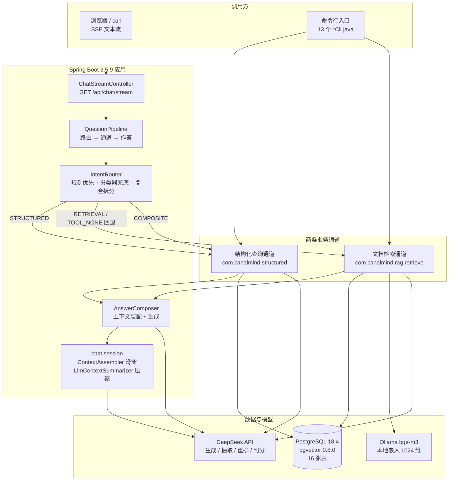
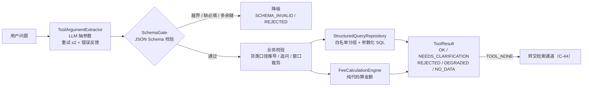
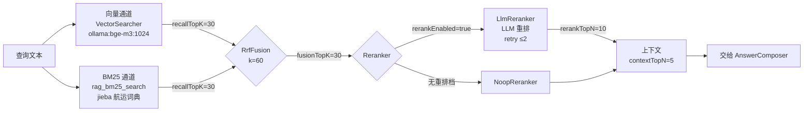
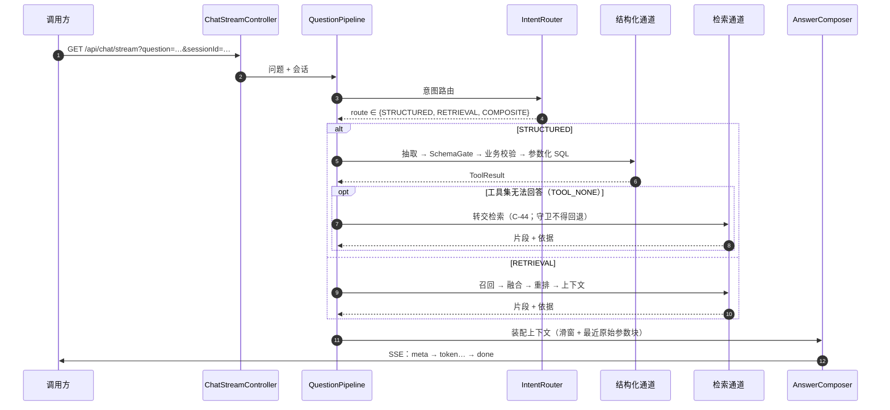
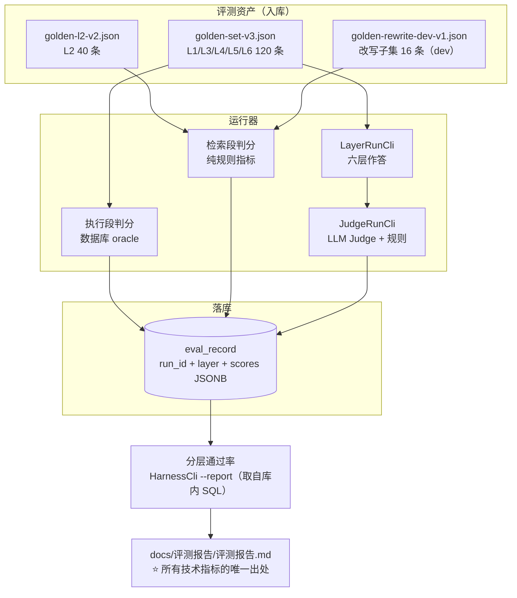
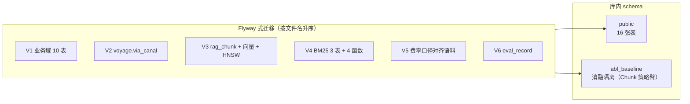

# CanalMind 架构图

> **本文件是项目架构的统一出处**，供 README 内嵌与面试讲述引用。
> 图中的每个组件名都能在代码里定位到（Java 包 `com.canalmind.*`）。
> ⚠️ **数字一律以 `docs/评测报告/评测报告.md` 为唯一出处**，本文件不复述指标，只画结构。

---

## 1. 系统全景

**读图要点**

- **路由决定"该查哪儿"**，两条通道各自独立可跑、也可单独评测（这是"分段口径"评测的基础）。
- **`TOOL_NONE` 回退**：结构化通道判定"这不是工具集能回答的问题"时**转交检索**（决策 **C-44**）。
  该回退有守卫——**越权/注入类问题不得回退**（`R0` 前置规则）。
- ⚠️ **`ContextSummarizer` 有生产实现但评测链路默认不启用**（决策 **C-53**，用户裁定）；
  L4 实测**压缩触发 0 次**（数据集最长对话 2 轮）。

---

## 2. 结构化查询通道（不让模型算钱）

**四条硬约束**

1. **金额一律由 `FeeCalculationEngine` 纯代码计算**（决策 **C-33**），模型只抽参数——
   不信任模型算术。实测与库内 `fee_record` **200/200 逐分一致**。
2. **契约是唯一出处**：`backend/src/main/resources/structured/tool-contracts.json`
   （版本 `1.0.0`，5 个工具 + 8 条业务规则 + 21 货种表）；envelope 的工具枚举**由工具清单派生**。
3. **SQL 一律参数化**，分组与口径走白名单。
4. **降级分 5 类**：`MODEL_ERROR` / `NOT_JSON` / `SCHEMA_INVALID` / `TOOL_UNKNOWN` /
   `MISSING_PARAMS`（追问）/ `TOOL_NONE`（交检索）。

> ⚠️ **能力边界（实测，`L6` 层）**：`limit` 超上限与 `group_by` 注入**当前连 `SchemaGate` 都没拦住**
> （实测返回 `OK` 而非 `REJECTED`），其中注入一题**属安全相关**，已登记为第 5 周优先项。
> 详见 `docs/评测报告/badcase记录.md` 与报告 §5.5。

---

## 3. 文档检索通道（召回 → 融合 → 重排 → 上下文）

**默认参数**（`RetrievalConfig.defaults()`，代码即事实）：
`recallTopK=30` / `fusionTopK=30` / `rerankTopN=10` / `contextTopN=5` / `rrfK=60` / `rerankEnabled=true`。

**两次实测校准（都是"量程"，不是"调参"）**

| 量程 | 原值 | 现值 | 依据 |
|---|---|---|---|
| 重排 `max_tokens` | 4096 | **8192** | 4096 档下 `rerankTopN=30` 实测 **3/3 必然降级**（`finish_reason=LENGTH`、正文为空）⇒ 推理 token 与正文共享输出预算 |
| 重排 `timeout` | 30 s | **90 s** | 单题重排实测均值 **29.4 s**，**正好压在 30 s 上**；一次**成功**的重排耗时 29.875 s，离旧上限只差 0.1 秒 |

两者都可用环境变量覆盖（`CANALMIND_RERANK_MAX_TOKENS` / `CANALMIND_RERANK_TIMEOUT_SECONDS`），
⚠️ **非法值抛异常，⛔ 不静默回退**。

**分词与索引口径**

- 分词只对 `content` 做（与向量通道**同一份输入**），使消融差异只能归因到"通道"。
- **档案身份 = 索引格式的一部分**：改词典/停用词/规则/K 参数必须新建档案
  （`jieba:shipping-dict-v1:rules-v2:INDEX`），库内守卫 `rag_assert_token_profile` 会拒绝就地重灌。
- ⚠️ **HNSW 索引"可用且结果正确"，但 541 行规模下规划器不选它**（实测 **≥1000 行才自发选**）
  ⇒ ⛔ 不得对外说"线上在用 HNSW"。

---

## 4. 一次问答的时序（含降级与回退）

**SSE 契约**：事件 `meta` / `token` / `done` / `error`；
**换行以下发字面量 `\n`**（`SseTextCodec`），前端必须用同一语义解码，否则事件边界会错位。

⚠️ **框架已知限制**：流式调用的异步路径会切到 `ForkJoinPool.commonPool()`，
导致 HTTP Span **挂不到模型 Span 下**（Spring AI 官方记录的限制）⇒ 本项目主打 SSE，
**这条限制必然遇到**；按纪律写进文档而不是当 bug 修。

---

## 5. 评测闭环

**评测纪律（写进图里，因为它就是设计的一部分）**

1. **口径不可混用**：严格族（只算 gold，**读作下界**）与可答族（含等价块）**必须并列报告**。
2. **严格/宽松口径都要给**（Judge 三层）。
3. **保留集只用于报告，⛔ 不用于调参**（调参只看 dev）。
4. **⛔ 不给未实测的组合编数字**；文档里的数字要能定位到报告。

---

## 6. 数据层与演进

- ⚠️ **`setup_local_db.ps1` 没有迁移账本**（类 Flyway 的 `schema_history`）⇒
  **已建库新增迁移不会自动应用，必须 `-Recreate`**。
- **库级参数**（零成本防未来规模增长）：`hnsw.iterative_scan = relaxed_order`、`hnsw.max_scan_tuples = 20000`
  ——`hnsw.*` 是**会话级**参数，靠应用里 `SET` 一次在**连接池**下不可靠。
- ⚠️ **批量入库后必须 `ANALYZE`**（已修进 `RagChunkRepository.analyzeChunkTable()`）：
  否则 `reltuples = -1`——"表里有数据"≠"规划器知道表里有数据"。

---

## 7. 相关文档

| 文档 | 内容 |
|---|---|
| `docs/评测报告/评测报告.md` | ⭐ **所有技术指标的唯一出处** |
| `docs/评测报告/badcase记录.md` | 逐条失败案例（含锚点与原因归属） |
| `docs/DECISIONS.md` | 全部已确认决策（C-xx）与待决决策点（D-xx） |
| `docs/进度看板.md` | 跨会话交接入口：当前状态、下一步、命令速查 |
| `docs/工程复盘/README.md` | 开发中真实踩坑的分类复盘 |
| `AGENTS.md` | 工程约定：决策分级、知识库参照、环境坑 |
